# Mini NPU Simulator — AI가 계산하는 방식을 흉내 내는 작은 계산기

## 목차

1. [프로젝트 개요](#프로젝트-개요)
2. [개발 환경](#개발-환경)
3. [실행 방법](#실행-방법)
4. [파일 구조](#파일-구조)
5. [구현 요약](#구현-요약)
6. [실행 증거 (텍스트 로그)](#실행-증거-텍스트-로그)
7. [결과 리포트](#결과-리포트)
8. [개발 중 겪은 문제와 해결 (트러블슈팅)](#개발-중-겪은-문제와-해결-트러블슈팅)
9. [과제 목표 정리](#과제-목표-정리)
10. [보너스 과제](#보너스-과제)

---

## 프로젝트 개요

사람은 그림을 보자마자 십자가(+)인지 X인지 알아보지만, 컴퓨터는 숫자만 이해합니다.
이 프로그램은 그림을 **숫자 2차원 배열(패턴)** 로 바꾸고, 기준 모양인 **필터**와
**같은 위치끼리 곱해서 모두 더하는 MAC(Multiply-Accumulate) 연산**으로 유사도 점수를 계산합니다.
그 점수로 패턴이 십자가인지 X인지 판정합니다.

AI 전용 칩(NPU)이 수천 개의 MAC 연산을 동시에 처리하는 원리를, 반복문으로 하나씩 처리하는 방식으로 흉내 낸 시뮬레이터입니다.

| 모드 | 하는 일 |
| --- | --- |
| 1. 사용자 입력 (3×3) | 필터 A, B와 패턴을 키보드로 입력받아 점수, 연산 시간, 판정(A / B / 판정 불가)을 출력 |
| 2. data.json 분석 | 5×5, 13×13, 25×25 패턴 6개를 일괄 판정하고 expected와 비교해 PASS/FAIL, 성능 표, 결과 요약을 출력 |
| 3. [보너스] 패턴 생성기 | 크기 N을 입력받아 N×N 십자가·X 패턴을 자동 생성하고, 생성 패턴으로 판정과 성능 분석 수행 |
| 4. [보너스] 1차원 최적화 비교 | 같은 입력·같은 반복 횟수로 2차원 방식과 1차원 방식의 MAC 연산 시간을 비교 |

---

## 개발 환경

- Python 3.8 이상 (WSL Ubuntu 터미널에서 `/usr/bin/python3`로 실행)
- 외부 라이브러리 미사용 (NumPy, pandas 등 사용하지 않음)
- 표준 라이브러리만 사용: `json`(파일 읽기), `time`(시간 측정)
- 편집기: VS Code

---

## 실행 방법

```bash
# 1. 저장소 복제
git clone https://github.com/haegirl23-max/mission3.git
cd mission3

# 2. 실행 (Python 3.8 이상)
python3 main.py
```

1. 실행하면 모드 선택 화면이 나옵니다. `1`~`4` 중 하나를 입력합니다. 다른 값을 넣으면 다시 묻습니다.
2. **모드 1**: 필터 A, 필터 B, 패턴을 차례로 한 줄에 숫자 3개씩(공백 구분), 3줄 입력합니다.
3. **모드 2**: `data.json`을 자동으로 읽습니다. **`data.json`은 `main.py`와 같은 폴더에 있어야 합니다.**
4. **모드 3 (보너스)**: 패턴 크기 N(3 이상 홀수)을 입력합니다.
5. **모드 4 (보너스)**: 입력 없이 바로 비교 표가 출력됩니다.

---

## 파일 구조

```
mission3/
├── main.py      # 프로그램 본체
├── data.json    # 모드 2용 문제 파일 (필터 + 패턴 + 정답)
├── README.md    # 이 문서
└── images/      # README에 넣은 실행·트러블슈팅 화면
```

### main.py 구성

| 함수 | 역할 |
| --- | --- |
| `normalize_label` | `+`, `cross`, `x` 등 제각각인 라벨을 표준 라벨 `Cross`, `X`로 통일 |
| `mac` | 이중 for문으로 같은 위치끼리 곱해 모두 더한 점수 반환 |
| `judge` | 두 점수를 epsilon 기준으로 비교해 승자 또는 `UNDECIDED` 반환 |
| `measure_ms` | `mac`을 10회 반복 실행해 평균 시간(ms) 반환 |
| `is_square` | 배열이 정확히 N×N인지 검사 |
| `read_matrix` | 키보드로 N줄 입력받기 (개수·숫자 검증 후 재입력 유도) |
| `make_cross`, `make_x` | N×N 십자가 / X 패턴 자동 생성 (성능 측정용) |
| `print_title`, `print_performance` | 구분선 제목, 성능 표 출력 |
| `run_user_mode` | 모드 1 전체 흐름 |
| `load_filters`, `analyze_pattern`, `fail`, `run_json_mode` | 모드 2: 필터 로드 → 케이스별 검증·판정 → 요약 |
| `read_size`, `print_matrix`, `run_generator_mode` | 보너스 1: 크기 N 입력·검증, 패턴 출력, 생성 패턴 판정과 성능 분석 |
| `flatten`, `mac_flat`, `measure_ms_with`, `run_optimize_mode` | 보너스 2: 2차원 → 1차원 변환, 반복문 하나짜리 MAC, 최적화 전/후 시간 비교 |
| `main` | 모드 선택 후 해당 모드 실행 |

### data.json 구조

```json
{
  "meta": { "version": "1.0", "type": "json" },
  "filters": {
    "size_5":  { "cross": [[...]], "x": [[...]] },
    "size_13": { "cross": [[...]], "x": [[...]] },
    "size_25": { "cross": [[...]], "x": [[...]] }
  },
  "patterns": {
    "size_5_1": { "input": [[...]], "expected": "x" },
    "size_5_2": { "input": [[...]], "expected": "+" }
  }
}
```

- 패턴 키 `size_{N}_{idx}`에서 가운데 숫자 N으로 사용할 필터 크기(`size_N`)를 고릅니다. 예: `size_13_2` → 13×13 필터.
- `meta`는 판정에 쓰지 않으므로 읽지 않습니다.

---

## 구현 요약

### 1. 라벨 정규화

data.json에는 같은 뜻의 라벨이 여러 표기로 섞여 있습니다. 필터 키는 `cross` / `x`이고, 정답(expected)은 `+` / `x`입니다.
비교하기 전에 프로그램 내부의 **표준 라벨 2가지(`Cross`, `X`)** 로 통일합니다.

| 입력 표기 | 표준 라벨 |
| --- | --- |
| `+`, `cross` | `Cross` |
| `x` | `X` |

- `str(raw).strip().lower()`로 앞뒤 공백을 지우고 소문자로 바꾼 뒤 비교합니다. 그래서 `" Cross "`, `"CROSS"`도 같은 라벨로 처리됩니다.
- 알 수 없는 라벨이면 `None`을 돌려주고, 해당 케이스는 "알 수 없는 expected 값"으로 FAIL 처리합니다.
- 콘솔 출력과 PASS/FAIL 비교는 모두 표준 라벨 기준입니다.

### 2. MAC 연산

```python
for i in range(n):          # 행
    for j in range(n):      # 열
        total += pattern[i][j] * filt[i][j]
```

- 외부 라이브러리 없이 **이중 for문**으로 N×N개의 모든 칸을 한 번씩 방문해 곱하고(Multiply) 누적합니다(Accumulate).
- 1이 겹치는 칸이 많을수록 점수가 커지므로, 점수가 높은 필터가 패턴과 더 닮은 것입니다.

### 3. 동점 처리 정책 (epsilon)

```python
EPSILON = 1e-9
if abs(score_a - score_b) < EPSILON:
    return "UNDECIDED"
```

- 컴퓨터는 소수를 2진수로 저장해 아주 작은 오차가 생깁니다(예: `0.1 + 0.2 = 0.30000000000000004`).
- 그래서 `==`로 비교하지 않고, **두 점수의 차이가 1e-9보다 작으면 동점(UNDECIDED)** 으로 봅니다.
- 동점 검사를 크기 비교보다 **먼저** 수행합니다. 순서가 바뀌면 오차 때문에 생긴 미세한 차이로 승자를 잘못 고르게 됩니다.
- 모드 1에서는 `판정 불가`, 모드 2에서는 `UNDECIDED`로 출력하고, 규칙에 따라 expected와 다르므로 FAIL 처리합니다.

### 4. 입력 검증과 예외 처리

| 상황 | 처리 |
| --- | --- |
| 모드 1: 한 줄의 숫자 개수가 3개가 아님 | "입력 형식 오류: 각 줄에 3개의 숫자를 입력해야 합니다." 출력 후 그 줄 재입력 |
| 모드 1: 숫자가 아닌 값 (`0 a 0`) | `float()` 변환 실패(ValueError)를 잡아 안내 후 재입력 |
| 모드 선택: 1, 2 이외의 값 | "1 또는 2를 입력하세요." 출력 후 재입력 |
| 모드 2: data.json 없음 / JSON 형식 오류 | 안내 메시지 출력 후 정상 종료 (에러로 멈추지 않음) |
| 모드 2: 키 형식 오류, 필터 없음, input/expected 없음 | 해당 케이스만 FAIL, 나머지는 계속 진행 |
| 모드 2: 패턴·필터 크기가 N×N이 아님 | `is_square`로 검사해 해당 케이스만 FAIL |

모드 2의 `analyze_pattern`은 **키 → 필터 존재 → 항목 존재 → 크기 → 라벨 → 연산** 순서로 검사합니다. 문제가 생기면 그 케이스만 실패 사유와 함께 FAIL로 기록하고 다음 케이스로 넘어가므로, 프로그램이 비정상 종료되지 않습니다.

### 5. 성능 측정 기준

- 크기별(3×3, 5×5, 13×13, 25×25)로 `mac()`을 **10회 반복**한 총 시간을 10으로 나눠 평균(ms)을 냅니다.
- `time.perf_counter()`로 **연산 함수 호출 구간만** 측정하고, 입력·출력·파일 읽기 시간은 포함하지 않습니다.
- 측정용 데이터는 `make_cross(n)` 패턴과 `make_x(n)` 필터로 자동 생성해, 모든 크기를 같은 조건으로 비교합니다.

---

## 실행 증거 (텍스트 로그)

### 1) 모드 1 — 십자가 필터 A, X 필터 B, 십자가 패턴 (정상 판정)

```
#[3] MAC 결과
#----------------------------------------
A 점수: 5.0
B 점수: 1.0
연산 시간(평균/10회): 0.002ms
판정: A
```

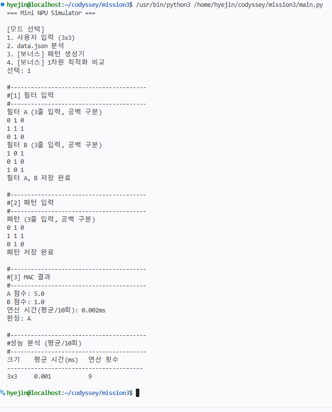

### 2) 모드 1 — 동점(판정 불가) + 잘못된 입력 재입력

```
필터 A (3줄 입력, 공백 구분)
0.1 0.1 0.1
0.1 0.1 0.1
0.1 0.1 0.1
필터 B (3줄 입력, 공백 구분)
0 0 0
0 0.9 0
0 0 0
필터 A, B 저장 완료

#[2] 패턴 입력
패턴 (3줄 입력, 공백 구분)
1 1 1
1 1
입력 형식 오류: 각 줄에 3개의 숫자를 입력해야 합니다.
1 1 1
1 1 1
패턴 저장 완료

#[3] MAC 결과
A 점수: 0.8999999999999999
B 점수: 0.9
연산 시간(평균/10회): 0.002ms
판정: 판정 불가 (|A-B| < 1e-09)
```

수학적으로는 A = 0.1 × 9 = 0.9, B = 0.9 × 1 = 0.9로 같은 점수입니다. 컴퓨터는 0.1을 9번 더하며 생긴 오차 때문에 A를 `0.8999999999999999`로 계산했고, epsilon 정책으로 동점 처리했습니다.

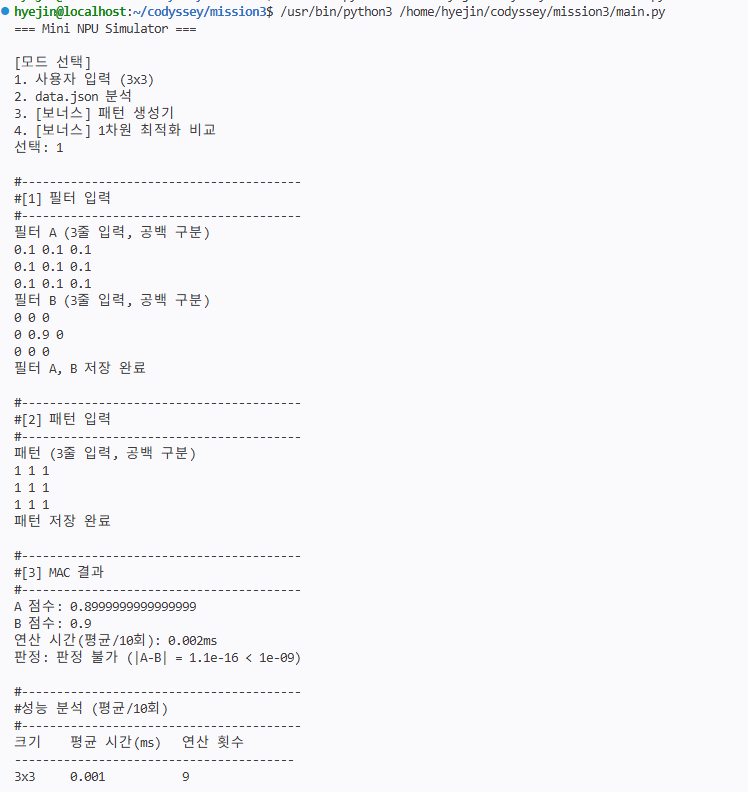

### 3) 모드 2 — data.json 분석

```
#[1] 필터 로드
✓ size_5 필터 로드 완료 (Cross, X)
✓ size_13 필터 로드 완료 (Cross, X)
✓ size_25 필터 로드 완료 (Cross, X)

#[2] 패턴 분석 (라벨 정규화 적용)
---size_5_1---
Cross 점수: 0.9
X 점수: 0.8999999999999999
판정: UNDECIDED | expected: X | FAIL
FAIL: 동점(UNDECIDED) 처리 규칙에 따라 FAIL
---size_5_2---
Cross 점수: 8.9
X 점수: 0.1
판정: Cross | expected: Cross | PASS
---size_13_1---
Cross 점수: 0.3
X 점수: 14.700000000000008
판정: X | expected: X | PASS
---size_13_2---
Cross 점수: 7.499999999999997
X 점수: 7.5
판정: UNDECIDED | expected: Cross | FAIL
FAIL: 동점(UNDECIDED) 처리 규칙에 따라 FAIL
---size_25_1---
Cross 점수: 4.9
X 점수: 4.899999999999999
판정: UNDECIDED | expected: X | FAIL
FAIL: 동점(UNDECIDED) 처리 규칙에 따라 FAIL
---size_25_2---
Cross 점수: 52.9
X 점수: 0.1
판정: Cross | expected: Cross | PASS

#성능 분석 (평균/10회)
크기    평균 시간(ms)   연산 횟수
----------------------------------------
3x3     0.001           9
5x5     0.002           25
13x13   0.006           169
25x25   0.037           625

#[4] 결과 요약
총 테스트: 6개
통과: 3개
실패: 3개

실패 케이스:
- size_5_1: 동점(UNDECIDED) 처리 규칙에 따라 FAIL
- size_13_2: 동점(UNDECIDED) 처리 규칙에 따라 FAIL
- size_25_1: 동점(UNDECIDED) 처리 규칙에 따라 FAIL
```

> 시간 값은 실행할 때마다 컴퓨터 상태에 따라 조금씩 달라집니다.

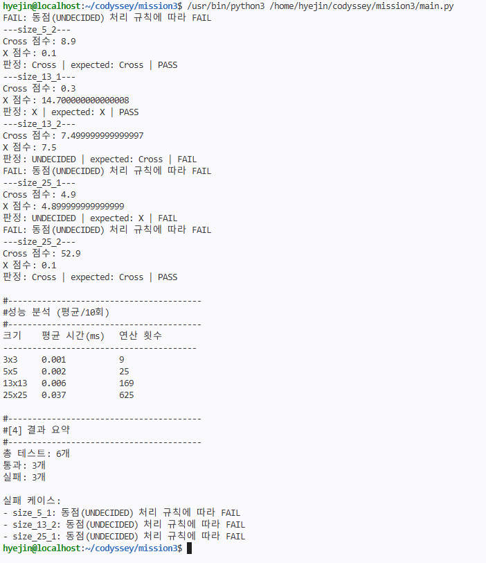

### 4) 의도적 오류 데이터 테스트 (재현성 확인)

data.json의 **복사본**을 고쳐서 확인했습니다.

| 고친 내용 | 결과 |
| --- | --- |
| `size_13_1`의 input에서 한 줄 삭제 (12줄) | `FAIL: 패턴 크기가 13x13이 아님`, 나머지 케이스는 정상 진행 |
| `size_5_2`의 expected를 `"o"`로 변경 | `FAIL: 알 수 없는 expected 값: o` |
| 존재하지 않는 파일 이름으로 실행 | `파일을 찾을 수 없습니다. main.py와 같은 폴더에 두세요.` 출력 후 정상 종료 |

---

## 결과 리포트

### 1. 결과 요약

- data.json 총 6개 케이스 중 **통과 3개, 실패 3개**
- 실패 3개(size_5_1, size_13_2, size_25_1)는 모두 **동점(UNDECIDED)** 으로 인한 FAIL
- 크기·키·라벨 오류로 실패한 케이스는 없음

### 2. 실패 원인 분석

실패 원인을 **데이터/스키마 문제, 로직 문제, 수치 비교 문제** 세 가지로 나눠 진단했습니다.

#### (1) 수치 비교 문제 — 최종 실패 3건의 원인

세 케이스 모두 패턴 자체는 깨끗한 X 또는 십자가입니다. 그런데 필터의 한 칸 값을 조절해 두 점수가 **수학적으로 정확히 같도록** 만들어져 있습니다.

| 케이스 | 패턴 | Cross 점수 (손 계산) | X 점수 (손 계산) | 프로그램 계산값 |
| --- | --- | --- | --- | --- |
| size_5_1 | X | 가운데 1칸 × 0.9 = 0.9 | 9칸 × 0.1 = 0.9 | 0.9 vs 0.8999999999999999 |
| size_13_2 | 십자가 | 25칸 × 0.3 = 7.5 | 가운데 1칸 × 7.5 = 7.5 | 7.499999999999997 vs 7.5 |
| size_25_1 | X | 가운데 1칸 × 4.9 = 4.9 | 49칸 × 0.1 = 4.9 | 4.9 vs 4.899999999999999 |

- 프로그램 계산값의 미세한 차이는 0.1, 0.3을 여러 번 더할 때 쌓이는 **부동소수점 오차**입니다.
- 필터만으로는 두 모양을 구분할 근거가 없으므로 `UNDECIDED`가 올바른 판정입니다. 규칙상 expected와 달라 FAIL이 됩니다.
- **epsilon 없이 `>`로만 비교했다면** size_5_1은 Cross, size_13_2는 X, size_25_1은 Cross로 판정됩니다. 셋 다 오차 때문에 엉뚱한 쪽을 승자로 고른 것이고, expected와도 모두 다릅니다. epsilon 정책은 이런 가짜 승부를 막고 "구분 불가"라고 정직하게 알려 줍니다.

#### (2) 로직 문제 — 개발 중 발생 후 해결

- **증상**: 처음 모드 2를 실행했을 때 6개 케이스가 모두 `size_N 필터에 Cross/X 중 하나가 없음`으로 FAIL했습니다.
- **원인**: 라벨 정규화 함수가 `"cross"`(소문자)를 반환했는데, 판정 코드는 `"Cross"`(대문자)를 찾고 있었습니다. 파이썬은 대소문자를 다른 글자로 보기 때문에, 필터가 있는데도 없는 것으로 처리됐습니다.
- **해결**: 표준 라벨을 `"Cross"`로 통일한 뒤 정상 판정(통과 3개)이 나왔습니다.
- **배운 점**: 정규화의 목적은 "비교하기 전에 이름표를 하나로 맞추는 것"이고, 표준 라벨을 정했으면 프로그램 전체에서 같은 표기를 써야 합니다.

#### (3) 데이터/스키마 문제

- 제공된 data.json에서는 발생하지 않았습니다.
- 크기 불일치, expected 오류 데이터를 일부러 만들어 테스트했고, 해당 케이스만 FAIL 처리되고 프로그램은 끝까지 실행되는 것을 확인했습니다([실행 증거 4)](#4-의도적-오류-데이터-테스트-재현성-확인) 참고).

### 3. 성능 분석과 시간 복잡도

| 크기 (N×N) | 평균 시간(ms) | 연산 횟수 (N²) | 5×5 대비 연산 | 5×5 대비 시간 |
| --- | --- | --- | --- | --- |
| 3×3 | 0.001 | 9 | — | — |
| 5×5 | 0.002 | 25 | 1배 | 1배 |
| 13×13 | 0.006 | 169 | 약 6.8배 | 약 3배 |
| 25×25 | 0.037 | 625 | 25배 | 약 18.5배 |

- MAC 연산은 N×N개의 칸을 한 번씩 방문해 곱셈 1번, 덧셈 1번을 합니다. 따라서 연산 횟수는 **N²** 이고, 시간 복잡도는 **O(N²)** 입니다.
- 한 변이 5 → 25로 5배가 되면 연산 횟수는 25 → 625로 **25배**(5²배)가 됩니다.
- 실측 시간도 0.002ms → 0.037ms로 약 18.5배 늘어, 연산 횟수 증가와 비슷한 추세를 보였습니다.
- 작은 크기(3×3, 5×5)에서는 시간이 0.001~0.002ms로 너무 짧습니다. 함수 호출 같은 고정 비용이 차지하는 비중이 커서 N²과 정확히 비례하지 않습니다.
- 측정값은 컴퓨터 상태에 따라 흔들리므로, 1회가 아닌 10회 평균을 사용해 흔들림을 줄였습니다.
- 실제 AI 모델은 수백×수백 크기의 필터로 이 연산을 수억 번 반복합니다. 크기가 2배가 되면 일이 4배가 되는 O(N²) 구조라서, 한 번에 하나씩 처리하는 CPU(직렬 처리)로는 감당하기 어렵습니다. 수천 개의 MAC을 동시에 처리하는 NPU(병렬 처리)가 필요한 이유입니다.

### 4. 실패가 0이 되려면

- 현재 3건의 FAIL은 데이터가 의도한 동점 케이스라서, 코드를 바꿔 PASS로 만들면 오히려 동점 규칙을 어기게 됩니다.
- 라벨 정규화(표기 통일)와 epsilon 비교(오차 허용)를 모두 적용했기 때문에, 동점이 아닌 3개 케이스는 표기 차이나 미세한 오차에 흔들리지 않고 모두 PASS했습니다.

---

## 개발 중 겪은 문제와 해결 (트러블슈팅)

| # | 증상 | 원인 | 해결 |
| --- | --- | --- | --- |
| 1 | 올바르게 `0 1 0`을 입력해도 계속 "입력 형식 오류" | `line.strip()`을 사용함. strip은 앞뒤 공백만 지워 `"0 1 0"`(5글자)이 그대로 남아 길이가 3이 아님 | `line.split()`으로 바꿔 `["0", "1", "0"]`(3개)로 분리 |
| 2 | 필터 A 입력 후 프로그램이 멈춘 것처럼 보임 | 입력 안내 문구가 없어 지금 필터 B를 입력할 차례인지 알 수 없었음 | `read_matrix`에 `"{title} (3줄 입력, 공백 구분)"` 출력 추가 |
| 3 | `"score_a" is not defined`, `"REPEAT" is not defined` 경고 | 점수 계산 3줄(`score_a`, `score_b`, `ms`) 누락, 상수 이름 오타(`REPET`) | 계산 줄 추가, 이름을 `REPEAT`로 통일 |
| 4 | `Expected ":"` 문법 오류 | `if` 줄 끝의 콜론 누락 | 콜론 추가. Enter 후 자동 들여쓰기가 안 되면 콜론 누락을 의심 |
| 5 | `Expected expression` 문법 오류 | `or` 뒤 조건에 검사할 값이 빠짐 (`or not in filters[n]`) | `or "X" not in filters[n]`처럼 `or` 양쪽을 완전한 조건으로 작성 |
| 6 | `AttributeError: 'str' object has no attribute 'spilt'` | `split` 철자 오타 | `split`으로 수정. 오류 메시지의 "Did you mean" 안내 활용 |
| 7 | 모드 2에서 6개 전부 FAIL | 정규화 함수가 소문자 `cross` 반환 (결과 리포트 2-(2) 참고) | 표준 라벨 `Cross`로 통일 |
| 8 | 성능 표에서 시간과 연산 횟수가 붙어 `0.0019`처럼 보이고, 제목과 숫자 열이 어긋남 | 오른쪽 정렬(`:>16`)로 숫자 사이 공백이 사라짐. 또 한글은 터미널에서 두 칸 너비인데, 파이썬 서식은 글자 수로 칸을 셈 | 왼쪽 정렬(`:<16`)로 변경. 제목 줄만 한글 글자 수만큼 칸을 줄임 (`<8`→`<6`, `<16`→`<12`) |

### 트러블슈팅 화면

**1·2. 입력 검증 동작과 안내 문구가 없던 상태** — 숫자 개수가 틀리거나(`0 1`), 숫자가 아닌 값(`0 a 0`)은 거부되고 재입력을 받습니다. 다만 안내 문구가 없어 다음 입력을 기다리는 줄 알 수 없었습니다.

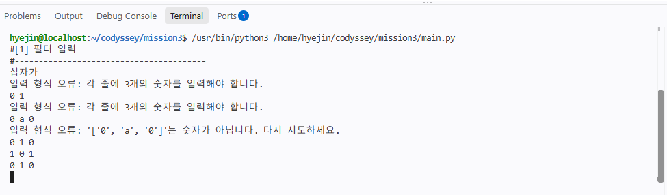

**3. 변수 미정의 경고 (VS Code Problems 창)**

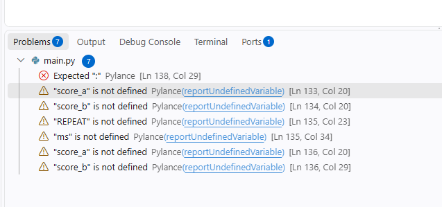

**4. 콜론 누락 문법 오류**

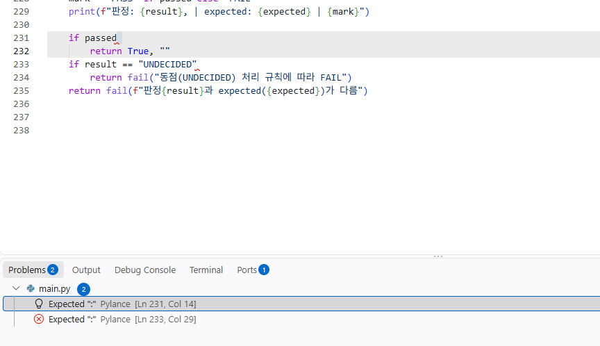

**5. `or` 뒤 조건 누락 오류**

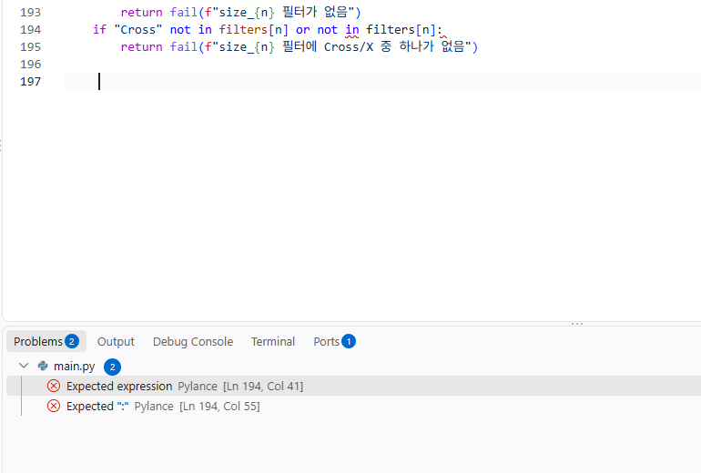

**6. split 철자 오타 (Traceback)**

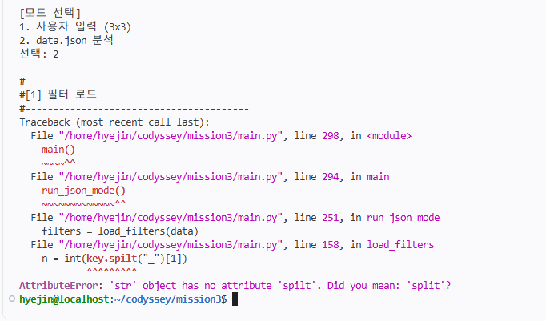

**7. 라벨 대소문자 불일치로 6개 전부 FAIL**

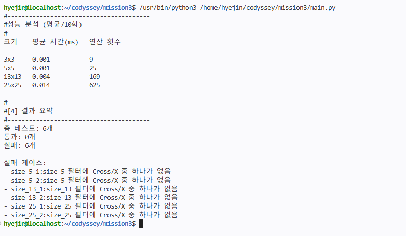

**8. 수정 전 성능 표 (시간 `0.001`과 연산 횟수 `9`가 붙어 `0.0019`로 출력)**

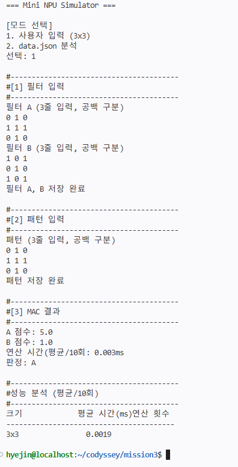

---

## 과제 목표 정리

| 과제 목표 | 정리 |
| --- | --- |
| MAC 연산이 무엇이고 AI에서 왜 중요한가 | 같은 위치끼리 곱해서 모두 더하는 연산입니다. AI는 이 연산을 수억 번 반복해 패턴을 인식하므로, 이를 빠르게 처리하는 NPU가 등장했습니다. |
| 곱하고 더해서 유사도를 계산하는 원리 | 패턴과 필터의 1이 같은 자리에 많이 겹칠수록 곱이 1인 칸이 많아져 합(점수)이 커집니다. |
| 키 규칙·라벨 규칙 해석과 정규화 이유 | `size_{N}_{idx}`의 N으로 필터를 고르고, `+`/`cross`/`x`를 `Cross`/`X`로 통일해야 같은 뜻을 같게 비교할 수 있습니다. |
| 부동소수점 오차와 epsilon 정책 | 소수 계산의 미세한 오차로 같은 점수가 다르게 보일 수 있어, 차이가 1e-9 미만이면 동점으로 처리합니다. |
| 크기별 시간 측정과 O(N²) | N×N 칸을 모두 방문하므로 연산 횟수가 N²이고, 측정 결과도 크기에 따라 비슷한 비율로 늘었습니다. |
| 실패 원인 분리 진단 | 실패를 데이터/스키마 · 로직 · 수치 비교로 나눠 진단했습니다. 최종 3건은 수치 비교(동점), 개발 중 6건은 로직(라벨 대소문자) 문제였습니다. |

---

## 보너스 과제

| 항목 | 상태 | 실행 |
| --- | --- | --- |
| 1. 패턴 생성기 | 구현 | 모드 3 |
| 2. 1차원 배열 최적화 | 구현 | 모드 4 |

### 보너스 1. 패턴 생성기 (모드 3)

**하는 일**: 크기 N을 입력받아 N×N 십자가(Cross)와 X 패턴을 자동으로 만들고, 만든 패턴을 판정과 성능 분석에 재활용합니다.

- **생성 규칙**
    - 십자가: 가운데 행(`i == N // 2`) 또는 가운데 열(`j == N // 2`)이면 1
    - X: 왼쪽 위→오른쪽 아래 대각선(`i == j`) 또는 오른쪽 위→왼쪽 아래 대각선(`i + j == N - 1`)이면 1
- **입력 검증**: N은 **3 이상의 홀수**만 받습니다. 짝수는 가운데 칸이 없어 십자가가 한쪽으로 치우치고, X의 두 대각선이 만나지 않기 때문입니다. 숫자가 아니거나 조건에 맞지 않으면 안내 후 다시 입력받습니다.
- **재활용**
    - 생성한 십자가·X 패턴을 필터로도 사용해, 각 패턴이 자기 모양으로 올바르게 판정되는지(PASS) 확인합니다.
    - 같은 생성 함수를 모드 1·2의 성능 분석 표에서도 측정용 데이터로 사용합니다.

**실행 예시 (N = 7)**

```
패턴 크기 N 입력 (3 이상 홀수, 예: 5): 4
입력 형식 오류: 3 이상의 홀수를 입력하세요. (짝수는 가운데 칸이 없어 십자가가 한쪽으로 치우칩니다)
패턴 크기 N 입력 (3 이상 홀수, 예: 5): 7

7x7 십자가(Cross) 패턴
0 0 0 1 0 0 0
0 0 0 1 0 0 0
0 0 0 1 0 0 0
1 1 1 1 1 1 1
0 0 0 1 0 0 0
0 0 0 1 0 0 0
0 0 0 1 0 0 0

7x7 X 패턴
1 0 0 0 0 0 1
0 1 0 0 0 1 0
0 0 1 0 1 0 0
0 0 0 1 0 0 0
0 0 1 0 1 0 0
0 1 0 0 0 1 0
1 0 0 0 0 0 1

#[2] 생성 패턴 판정 (필터도 생성 패턴 사용)
Cross 패턴 → Cross 점수: 13.0, X 점수: 1.0, 판정: Cross | PASS
X 패턴 → Cross 점수: 1.0, X 점수: 13.0, 판정: X | PASS
```

- 7×7 십자가는 가로 7칸 + 세로 7칸 − 겹치는 가운데 1칸 = 13칸이 1이라서, 자기 자신과의 점수가 13입니다.
- 십자가와 X는 가운데 1칸만 겹치므로 서로의 점수는 1입니다.

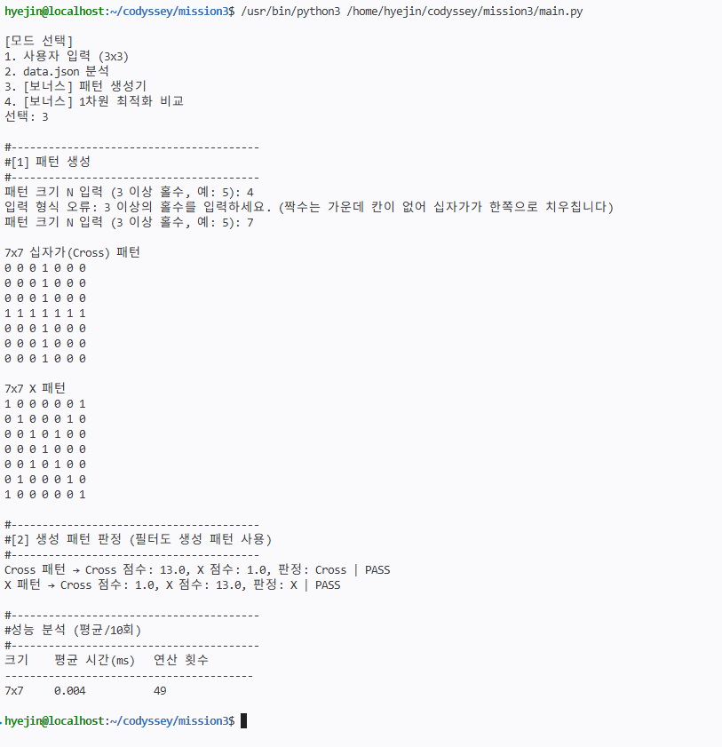

### 보너스 2. 1차원 배열 최적화 (모드 4)

**하는 일**: N×N 2차원 배열을 길이 N²의 1차원 배열로 편 뒤, 반복문 하나로 MAC 연산을 합니다. 그리고 기존 2차원 방식과 시간을 비교합니다.

```python
# 최적화 전 (2차원): 반복문 두 겹, 칸마다 [i][j] 두 번 찾아감
for i in range(n):
    for j in range(n):
        total += pattern[i][j] * filt[i][j]

# 최적화 후 (1차원): 반복문 하나, 칸마다 [k] 한 번만 찾아감
for k in range(len(flat_a)):
    total += flat_a[k] * flat_b[k]
```

**공정한 비교를 위한 조건**

- **동일 입력**: 같은 크기의 `make_cross(n)` 패턴과 `make_x(n)` 필터를 사용합니다.
- **동일 반복 횟수**: 두 방식 모두 1,000회씩 반복해 평균을 냅니다. 필수 기능의 10회로는 시간이 0.001ms 수준이라 차이가 측정 오차에 묻혀서, 보너스 비교에서만 반복 횟수를 늘렸습니다.
- **변환 시간 제외**: 2차원 → 1차원으로 펴는 작업은 측정 전에 한 번만 하고, 연산 함수 호출 구간만 잽니다.
- **결과 검증**: 두 방식의 점수가 같은지(epsilon 기준) "점수 일치" 열로 확인합니다.

**측정 결과**

```
크기    2차원(ms)   1차원(ms)   속도 비율 점수 일치
----------------------------------------------------
3x3     0.0005      0.0003      1.80      O
5x5     0.0012      0.0005      2.28      O
13x13   0.0062      0.0035      1.78      O
25x25   0.0220      0.0141      1.55      O
```

> 속도 비율 = 2차원 시간 ÷ 1차원 시간. 1보다 크면 1차원 방식이 더 빠릅니다. 시간 값은 실행할 때마다 조금씩 달라집니다.

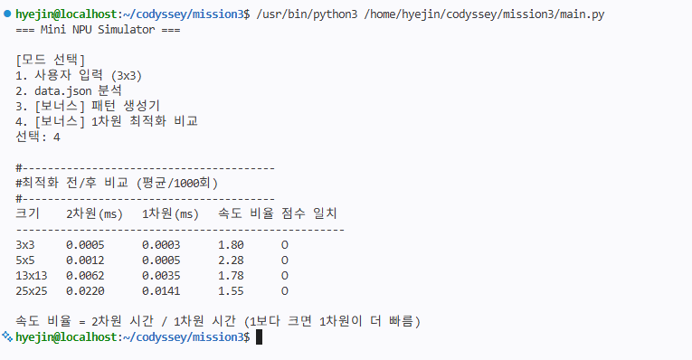

**분석**

- 모든 크기에서 1차원 방식이 더 빨랐고(약 1.55~2.28배), 두 방식의 점수는 모두 같았습니다.
- 1차원 방식이 빠른 이유는 두 가지입니다.
    - **찾아가는 횟수가 줄어듦**: 2차원은 칸마다 "몇 번째 줄 → 그 줄의 몇 번째 칸"으로 두 번 찾아가지만, 1차원은 한 번에 찾아갑니다.
    - **반복문 준비 비용이 줄어듦**: 2차원은 줄마다 안쪽 반복문을 새로 시작하는 비용이 듭니다.
- 5×5 이후로는 크기가 커질수록 속도 비율이 줄어들었습니다(5×5 2.28배 → 13×13 1.78배 → 25×25 1.55배). 칸이 많아지면 곱셈·덧셈 자체에 드는 시간이 대부분을 차지해서, 줄여 준 준비 비용의 비중이 작아지기 때문입니다.
- 3×3(1.80배)이 5×5보다 낮게 나온 것은 측정 시간이 0.0003~0.0005ms로 매우 짧아, 작은 흔들림에도 비율이 크게 바뀌기 때문으로 보입니다. 실행할 때마다 이 값은 달라질 수 있습니다.
- **시간 복잡도는 두 방식 모두 O(N²)로 같습니다.** 1차원 방식도 N²개의 칸을 모두 방문해야 하기 때문입니다. 최적화로 바뀐 것은 "칸 하나를 처리하는 데 드는 시간(상수)"이지, 크기에 따라 늘어나는 비율이 아닙니다.
- 컴퓨터 메모리는 원래 데이터를 한 줄로 이어서 저장하므로, 한 줄로 편 데이터를 순서대로 읽는 방식이 하드웨어 구조에도 잘 맞습니다. 이 최적화는 그 원리를 작게 흉내 낸 것입니다.
